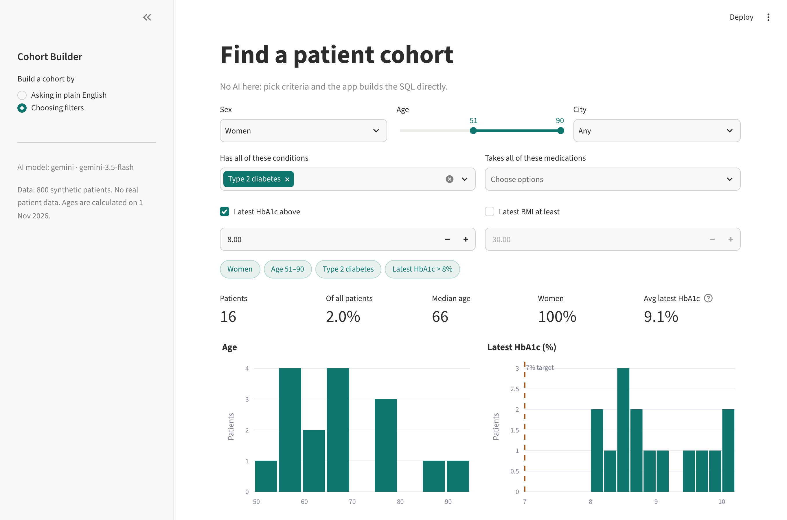

# Patient Cohort Builder

Type a question like **"diabetic women over 50 with an HbA1c above 8"** and get the matching patients, the SQL behind them, and a dashboard of the cohort.

An LLM (free tier only) turns plain English into SQL over synthetic patient data, guardrails check the SQL before it runs, and a Streamlit dashboard shows the result. Built by Ananae, drawing on cohort and dashboard design work at WellStack.



**Results:** 12 of 13 benchmark questions answered correctly with Gemini 3.5 Flash (free tier), all on the first try. 12 of 12 safety and correctness checks pass. All data is synthetic.

## Run it (Windows)

From your `AI Learning` folder in PowerShell:

```powershell
.\.venv\Scripts\Activate.ps1
cd cohort-builder
pip install -r requirements.txt      # once
streamlit run app.py                 # opens the dashboard in your browser
```

The app reads your free Gemini key from `AI Learning\.env` (`GEMINI_API_KEY=...`). No key? The **Choosing filters** mode works without any AI.

Other useful commands:

```powershell
python tests\test_core.py                     # 12 safety and correctness checks, no API key needed
python eval\run_eval.py                       # score the AI on 13 benchmark questions (~2 min, uses free quota)
python src\nl_to_sql.py "women over 60 on insulin"   # try one question in the terminal
python data\generate_data.py                  # rebuild the database (same data every time)
```

### Switching to another free model

Add these to `.env` if Gemini's free quota runs out:

| Provider | Add to .env |
|---|---|
| Groq (free key at console.groq.com) | `LLM_PROVIDER=groq` and `GROQ_API_KEY=...` |
| Ollama (local, no key) | `LLM_PROVIDER=ollama`, then run `ollama pull qwen2.5-coder:7b` |

`LLM_MODEL=...` overrides the model name for any provider.

## How it works

```
question ─► LLM writes SQL + assumptions (JSON) ─► guardrails check ─► run read-only ─► dashboard
                ▲                                                          │
                └──────────── error fed back, up to 3 tries ◄──────────────┘
```

- **Grounded prompt** (`src/nl_to_sql.py`): the schema doc, fixed rules (how to compute age, "latest" lab value, codes not descriptions) and 3 worked examples. None of the examples are benchmark questions, so the eval score is honest.
- **Shows its assumptions**: the model must list how it read the question, such as "Used the most recent HbA1c". The dashboard shows them as chips, so the user can spot a wrong reading.
- **Asks when the question is vague**: "show me sick old people" gets a clarifying question instead of a guess.
- **Fixes its own mistakes**: if the SQL fails, the error goes back to the model, up to 3 tries. The dashboard shows any failed attempts under "Show the SQL".
- **Two layers of safety** (`src/guardrails.py`, `src/db.py`): text checks give a friendly message, and the database itself is opened read-only with SQLite's authorizer, which refuses anything except reads from the 4 tables. Slow queries are stopped after 5 seconds.
- **No-AI mode** (`src/cohort.py`): the same cohort from filters, with parameterised SQL.

## Folder layout

```
cohort-builder/
├── app.py                   # Streamlit dashboard
├── src/
│   ├── db.py                # read-only connection, safety authorizer, patient details
│   ├── cohort.py            # filters → SQL, no AI
│   ├── llm.py               # Gemini / Groq / Ollama wrapper (all free)
│   ├── nl_to_sql.py         # English → SQL with checks and self-correction
│   └── guardrails.py        # SQL safety checks
├── eval/
│   ├── golden_questions.csv # 13 questions with correct answers
│   └── run_eval.py          # scores the AI, saves results_DATE.csv
├── tests/test_core.py       # checks that need no API key
├── data/                    # generate_data.py, cohort.db, csv/
├── docs/schema.md           # tables and codes (also part of the AI prompt)
└── exercises/
    ├── ex01_first_queries.py   # SQL by hand
    └── practice/               # blank TODO versions of the app files, to write yourself
```

## The plan

**Status (14 Nov 2026):** phases 1 to 5 are built and working, written by Claude at your request. Blank versions are in `exercises/practice/` if you want to write them yourself as you reach each week. Phase 0 (SQL by hand) and Phase 6 (real Synthea data and deploying) are still yours.

| Phase | When | You build | Done when |
|---|---|---|---|
| **0. SQL by hand** | Week 1, now | `exercises/ex01_first_queries.py`: 6 queries ending with the real cohort | all 6 show ✓ and you've answered the reflection |
| **0b. Same thing in pandas** | Week 1, after pandas basics | `exercises/ex02` (I'll add it when you finish ex01): load the CSVs, compute age, latest HbA1c with `groupby`, merge | pandas also gets 16 |
| **1. Cohort builder without AI** | End of Week 1 | `src/cohort.py`: `CohortFilters` → parameterised SQL → DataFrame | `python src/cohort.py` prints 16 patients |
| **2. English → SQL** | Week 2 (JSON output, text-to-SQL days) | `src/nl_to_sql.py` with Gemini free tier: schema in the prompt, few-shot examples, JSON with `sql` + `assumptions` | 5 of your own questions give sensible SQL |
| **3. Guardrails + evaluation** | Week 2 | `src/guardrails.py` and `eval/run_eval.py` | an eval score you can quote, e.g. "11/13", and a `DROP TABLE` prompt is blocked |
| **4. Dashboard** | End of Week 2 (Streamlit day) | `app.py`: sketch first, then query box, assumption chips, KPI tiles, 2 charts, SQL expander, CSV export, empty and error states | a friend can use it without you explaining |
| **5. Make it an agent** | Week 3 | the LLM gets tools (`run_sql`, `get_schema`), retries when SQL fails, asks a clarifying question when a request is vague ("older patients" → what age?) | it fixes its own broken SQL at least once in the eval |
| **6. Real data + ship** | Week 4 | swap in real Synthea output, deploy on Streamlit Community Cloud (free), README case study with screenshots, push to GitHub | public link on your resume and LinkedIn |

### Moving to real Synthea data (Phase 6)

Synthea is an open-source synthetic patient generator from MITRE. Two routes, both free:

1. **Pre-made sample**: download a ready-made CSV sample from the Synthea downloads page (synthea.mitre.org/downloads) and load the `patients`, `conditions`, `observations` and `medications` CSVs.
2. **Generate your own**: install Java 17+, download `synthea-with-dependencies.jar` from the Synthea GitHub releases, then run
   `java -jar synthea-with-dependencies.jar -p 1000 --exporter.csv.export true Massachusetts`.

The columns in this project already match Synthea's names, so your code should mostly work unchanged. Expect real Synthea to have messier edges (more codes, deceased patients, encounters), which makes good Week 4 material.

## Rules for this project

- **Free tools only.** Gemini (AI Studio free tier), Groq, GitHub Models or Ollama. Never a paid API.
- **Synthetic data only.** No real patient data, ever. Say so in the README you publish.
- **Learning first.** The working app is here to study and extend. Re-building the practice files yourself is still the best way to learn it.
